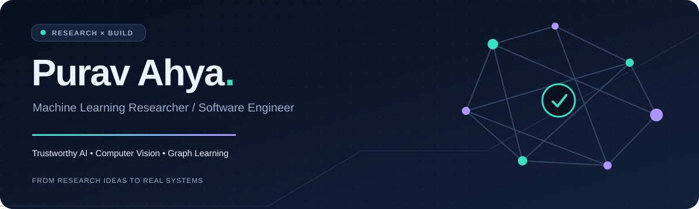
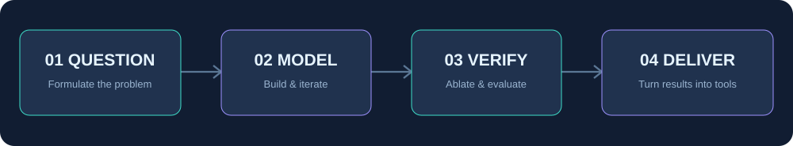

<!-- Profile repository: github.com/purav-12345/purav-12345 -->
<!-- Assets are relative and bundled with this README. -->

<picture>
  <source media="(prefers-color-scheme: dark)" srcset="./assets/hero-dark.svg">
  <source media="(prefers-color-scheme: light)" srcset="./assets/hero-light.svg">
  
</picture>

 

Computer Vision · Trustworthy ML · Graph Representation Learning · AI Systems

---

### 👋 The short version

I'm **Purav Ahya** — I work across **AI research and practical software engineering**, from biometric image restoration and medical vision models to graph learning, credit-risk systems and retrieval-augmented AI.

I focus on a question that connects most of my work: **How do we make powerful models reliable, interpretable and useful beyond the experiment?**

<table>
<tr>
<td width="50%" valign="top">

**🔍 Research mindset**

Computer vision · Transformers · GNNs · Calibration · Explainability · Multimodal learning

</td>
<td width="50%" valign="top">

**🧱 Engineering mindset**

Python · PyTorch · TensorFlow · FastAPI · Docker · SQL · Data pipelines

</td>
</tr>
</table>

## 🧪 Research at a glance

<table>
<tr>
<td align="center" width="33%"><h3>07</h3>Conference papers listed in my résumé</td>
<td align="center" width="33%"><h3>06</h3>Research, industry &amp; teaching roles</td>
<td align="center" width="33%"><h3>03</h3>Selected projects featured below</td>
</tr>
</table>

<b>🧭 Open my research map — themes and representative work</b>

 

| Research theme | What I've worked on |
|:--|:--|
| **Vision & biometrics** | Fingerprint restoration, super-resolution, liveness detection at IIT Bombay |
| **Trustworthy medical AI** | Calibrated image classifiers, uncertainty and out-of-distribution detection |
| **Graph machine learning** | Credit scoring with GCN/GAT and explainable risk assessment |
| **Language & multimodal AI** | Cybersecurity RAG, multilingual audiovisual translation |
| **Applied analytics** | Credit-risk modeling, IoT energy profiling, AI-assisted learning |

### How I approach a problem

## 🚀 Selected projects

<table>
<tr>
<td width="50%" valign="top">
<h3>🛡️ Cyber.AI</h3>
<b>Security intelligence through retrieval + reasoning</b>

A cybersecurity knowledge workflow combining SecureBERT, retrieval-augmented generation, clustering, topic modeling and knowledge graphs to surface relevant threats and vulnerability insights.

<code>RAG</code> <code>SecureBERT</code> <code>FastAPI</code> <code>Knowledge Graphs</code>
  
<a href="https://github.com/purav-12345?tab=repositories">Browse repositories →</a>
</td>
<td width="50%" valign="top">
<h3>🎬 Indic A/V Translation</h3>
<b>Speech-to-speech translation with lip synchronization</b>

English-to-Indic ASR → NMT → TTS workflow with Wav2Lip-based visual dubbing. Project evaluation reported <b>BLEU 31.5</b>.

<code>PyTorch</code> <code>NMT</code> <code>GANs</code>
  
<a href="https://github.com/purav-12345?tab=repositories">Browse repositories →</a>
</td>
</tr>
<tr>
<td width="50%" valign="top">
<h3>🩺 SpectraScan</h3>
<b>Medical modeling across multimodal signals</b>

Sequential learning for Parkinson's biomarker progression (<b>88% early-stage accuracy</b>) and cross-attention fusion of mammography and metadata (<b>0.95 AUC</b>) in project evaluation.

<code>TensorFlow</code> <code>Flask</code> <code>scikit-learn</code>
  
<a href="https://github.com/purav-12345?tab=repositories">Browse repositories →</a>
</td>
<td width="50%" valign="top">
<h3>🔬 Applied biometric research</h3>
<b>High-fidelity restoration and anti-spoofing</b>

At IIT Bombay, worked on fingerprint super-resolution and biometric liveness detection, spanning frequency-domain preprocessing, U-Net-based restoration and hand-tracking workflows.

<code>Computer Vision</code> <code>U-Net</code> <code>Biometrics</code>
  
<a href="#-experience--impact">See experience →</a>
</td>
</tr>
</table>

> **Project note:** Metrics above are the results reported in my résumé, not independently reproduced benchmarks. Repository links lead to my repository index until individual source links are added.

## 📚 Publications

Seven conference papers listed in my résumé. Open each research area to see the corresponding papers. *Links to publisher records can be added when verified.*

<b>📈 Financial AI &amp; Graph Learning · 4 papers</b>

 

1. **Comparative Analysis of Optimized Machine Learning and Deep Learning Models for Credit Risk Prediction**  
   P. Ahya, I. Bamel, S. Chandra · *1st IEEE International Conference on Data Science and Intelligent Network Computing* (2025)
2. **Evaluating Graph Neural Network Architectures for Credit Scoring: A Comparative Analysis**  
   P. Ahya, J. Sisodia, K. Devadkar · *2nd IEEE International Conference on Computational Intelligence and Computing Applications* (2025)
3. **Hybrid Optimization and Explainability-Driven Framework for Creditworthiness Assessment**  
   P. Ahya, I. Bamel, S. Chandra · *IEEE 4th International Conference for Advancement in Technology* (2025)
4. **Graph Neural Approaches to Credit Scoring: Interpretable Learning with GCN and GAT**  
   P. Ahya, J. Sisodia, K. Devadkar · *2nd Asia Pacific Conference on Innovation in Technology* (2025)

<b>🧬 Medical AI &amp; Transformers · 2 papers</b>

 

5. **Uncertainty-Aware Osteoporosis Classification with Calibrated Transformer and OOD Detection**  
   P. Ahya, J. Sisodia, K. Devadkar · *7th International Conference on Innovative Data Communication Technologies and Application* (2025)
6. **Comparative Analysis of Transformer Models for Skin Lesion Detection**  
   I. Bamel, P. Ahya, R. Sawant · *4th IEEE International Conference on Computer Vision and Machine Intelligence* (2025)

<b>🚦 Forecasting &amp; Sequence Modeling · 1 paper</b>

 

7. **Memory Augmented Transformers for Scalable Urban Traffic Forecasting**  
   M. Vala, V. Gangwani, P. Ahya, K. Devadkar · *International Conference on Intelligent &amp; Innovative Practices in Engineering &amp; Management* (2025)

## 💼 Experience & impact

| Where | Role | Work that mattered |
|:--|:--|:--|
| **IIT Bombay** | Research Intern | Fingerprint restoration, 95% minutiae preservation in a reported experiment, liveness research |
| **Sonicbolt Technologies** | IoT & Data Engineering Intern | Processed 25K+ hourly records/month; standardized data for 120+ devices |
| **SPIT** | Teaching Assistant | Supported OOP and AI/Soft Computing laboratory teaching |
| **ADN Fire Safety** | SDE Intern | Restructured 1,500+ historical transactions and procurement analytics |
| **OnEMI** | Data Analytics Intern | Alternative-data credit modeling and LLM-based query classification |

## 🧰 Tools I reach for

**AI & modeling**

**Software & infrastructure**

**Data layer**

<b>+ More of my toolkit</b>

 

**Languages:** Python, C++, C, JavaScript, SQL, Java, R, MATLAB  
**ML/NLP:** scikit-learn, spaCy, Hugging Face Transformers, OpenCV, MLflow  
**Systems/data:** Flask, Django, Node.js, PostgreSQL, MySQL, MongoDB, Neo4j, Weaviate, Kubernetes, Docker

## 🏅 Highlights beyond code

- 🥇 **Hackathon wins:** DataHack 3.0 and SPIT SE Hackathon (2024); **runner-up** at Technovate 2.0 (2024)
- 🏅 **Samvaad Award**, UIDAI (2025); **Academic Excellence Award**, SPIT
- 🎓 **NPTEL Topper** in *Social Networks* (IIT Madras) and *Data Analytics with Python* (IIT Roorkee)
- 📖 **Reviewer**, IEEE Contemporary Computing Innovations Conference (2026); **Hackathon Mentor**, SPIT (2025)

## 📊 GitHub pulse

Live statistics are supplied by a third-party service and can sometimes fail to load. They are not a measure of research quality.

---

### Have a research question or a problem worth building for?

**Let's compare ideas, test assumptions, and ship something useful.**

Designed to work as a GitHub profile README · No scripts or GitHub Actions required

